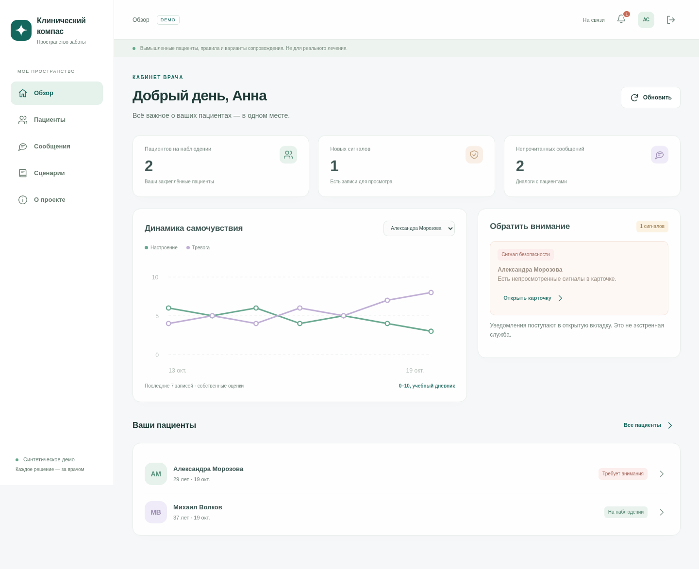

# Клинический компас · интерактивное PWA-демо

Мобильное приложение для демонстрации сопровождения пациента: **от дневника самочувствия до решения врача**. Работает в браузере на компьютере и телефоне; с HTTPS устанавливается на главный экран Android/iPhone.

**Все профили, истории, правила и варианты сопровождения синтетические. ДЕМО-Альфа, ДЕМО-Бета и ДЕМО-Гамма — вымышленные названия, не лекарства.** Медицинских назначений, дозировок и настоящих рекомендаций приложение не содержит.



[Мобильный кабинет пациента](docs/screenshots/mobile.png)

## Что доступно

**Врачу:** обзор пациентов, поиск и фильтр внимания, карточка с динамикой и контекстом, сигналы безопасности, согласование предложений, варианты сопровождения, ручные решения, переписка и журнал действий.

**Пациенту:** «Мой день», самоотчёты, история и график, подтверждённый врачом план, решения и переписка с ведущим врачом. Пациент не может менять план или смотреть чужие данные.

**Совместная работа:** отдельные серверные сессии, уведомления при открытом приложении, подтверждение получения уведомления приложением и отдельная отметка просмотра, сообщения с отметками прочтения. Опрос каждые 5 секунд в видимой вкладке; входящие сообщения не стирают набираемый текст.

**Визуал:** разные кабинеты, адаптивный обзор и карточки, боковая навигация на компьютере, нижняя — на телефоне, график последних 14 записей, категории «обязательно в демо» и «желательно в демо».

## Быстрый запуск

Нужен Python 3.10+ (проверено на 3.12). Если репозиторий уже скачан, в его папке выполните `git pull --ff-only origin main`; повторно клонировать не нужно. Остановите запущенную старую версию перед обновлением.

```bash
git clone https://github.com/Alimey/clinical_compass_mvp.git
cd clinical_compass_mvp
python -m venv .venv
```

Windows PowerShell:

```powershell
.\.venv\Scripts\python.exe -m pip install -r requirements.lock
.\.venv\Scripts\python.exe app.py
```

macOS / Linux:

```bash
.venv/bin/python -m pip install -r requirements.lock
.venv/bin/python app.py
```

Откройте `http://127.0.0.1:8000` на компьютере. Остановка: Ctrl+C. Node.js и сборка интерфейса для запуска не нужны. Gunicorn пропускается при установке на Windows.

При первом запуске новая база получает синтетическую историю за 7 дней, два основных сценария и пример предложения. Истории существующих пациентов не перезаписываются; если в старой базе уже были отчёты, пример истории к ним не подмешивается. Для демонстрации всех новых сценариев используйте **отдельный новый путь** базы, например `COMPASS_DB=instance/showcase-v2.db`, сохранив прежнюю базу.

## Демо-вход

На стартовом экране — кнопки входа врача и двух пациентов. Это настоящие отдельные сессии с серверной проверкой роли, но аккаунты намеренно общедоступны.

| Логин | Роль | Назначение |
|---|---|---|
| `doctor` | Врач Анна Соколова | Пациенты Александра и Михаил |
| `patient-a` | Пациент Александра Морозова | Сценарий внимания к безопасности |
| `patient-b` | Пациент Михаил Волков | Сценарий планового наблюдения |
| `doctor-other` | Другой врач | Проверка изоляции доступа, только пациент Виктория |
| `patient-c` | Пациент другого врача | Проверка изоляции доступа |

**Демо-пароль всех аккаунтов: `compass-demo`.** Можно использовать форму «Войти по логину и паролю». Сессия действует 8 часов; выход отзывает её на сервере.

Не используйте настоящие персональные или медицинские данные. Публичный демо-пароль не позволяет рассматривать эти аккаунты как защиту реальных сведений.

## Сценарий для показа

1. В обычном окне войдите врачом. Посмотрите обзор, график и сигнал Александры.
2. В отдельном приватном окне или на телефоне войдите Александрой. Откройте «Дневник», сохраните вымышленный самоотчёт с отметкой опасений за безопасность.
3. Врач получит уведомление в открытую вкладку. Откройте уведомление, проверьте сигнал и отметьте его просмотренным. Для обновления обзора есть кнопка «Обновить»; введённые формы не обновляются принудительно.
4. В карточке откройте «План и варианты». Увидите основания, версию учебных правил и разные приоритеты. Подтвердите или отклоните предложение с обоснованием.
5. Подтвердите «ДЕМО-Альфа»: только после этого изменится план пациента. «ДЕМО-Бета» для Александры блокируется из-за вымышленной несовместимости. Проверка действует и на сервере.
6. У пациента откройте «Мой план». Затем обменяйтесь сообщениями; проверьте доставку и отметку прочтения в переписке.
7. У врача откройте «Журнал»: там сохранены события. Перейдите к Михаилу — у него отдельные история, решения и диалог.

Для одновременной работы двух ролей нужны **разные браузеры, профили или обычное/приватное окно**: вкладки одного профиля используют одну cookie-сессию.

## Учебные правила, не клинические алгоритмы

Правила вынесены в `compass/rules.py`, версия `synthetic-2.0`. Они формируют предложения, но не ставят диагноз, не назначают лечение и не выполняют настоящие направления.

| Правило | Условие | Результат в демо |
|---|---|---|
| S-01 | Отмечены опасения за безопасность | Сигнал врачу и обязательное предложение проверить безопасность / маршрутизацию |
| S-02 | Тревога ≥ 8 или настроение ≤ 2, без S-01 | Желательное предложение обсудить консультацию |
| S-03 | Поле самочувствия не пустое | Обязательное предложение уточнить переносимость; смысл текста не анализируется |
| S-04 | Соблюдение плана «Нет» или «Частично» | Желательное предложение обсудить трудности |

Пороги придуманы для демонстрации интерфейса. Вопросы не являются валидированной шкалой. Условный индекс соблюдения: «Да» = 1, «Частично» = 0,5, «Нет» = 0, среднее по последним 7 записям; «Не применимо» исключается. Решения врача и предложения сохраняются отдельно. Отметка просмотра сигнала сама по себе не подтверждает предложение и не меняет план.

## Опробовать на телефоне в одной Wi-Fi сети

Windows PowerShell:

```powershell
$env:COMPASS_HOST = "0.0.0.0"
.\.venv\Scripts\python.exe app.py
```

macOS / Linux:

```bash
COMPASS_HOST=0.0.0.0 .venv/bin/python app.py
```

Узнайте локальный IPv4 компьютера (`ipconfig` на Windows, настройки Wi-Fi на macOS/Linux). На телефоне откройте `http://IP-КОМПЬЮТЕРА:8000`, например `http://192.168.1.10:8000`. Оба устройства должны быть в одной сети. При необходимости разрешите TCP 8000 в брандмауэре для частной сети. Компьютер и сервер должны оставаться включёнными.

HTTP в локальной сети подходит для проверки интерфейса и форм. Установка PWA и service worker на телефоне требуют **HTTPS**; исключение localhost относится только к самому устройству.

## HTTPS-размещение и установка PWA

Для Linux:

```bash
COMPASS_SECURE_COOKIES=1 .venv/bin/gunicorn --bind 0.0.0.0:8000 --workers 1 --threads 4 'app:create_app()'
```

Подключите HTTPS reverse proxy, сохраняющий исходный `Host`. `COMPASS_SECURE_COOKIES=1` включает Secure для cookies; используйте его только с HTTPS. Недоверенные forwarded-заголовки не используются для определения роли, IP или защищённости сессии. Внешний порт Gunicorn задаётся через `--bind`; `PORT` используется при `python app.py`.

SQLite должен находиться на постоянном диске: `COMPASS_DB=/data/compass.db`. Без него после пересоздания сервера можно потерять записи. Это демонстрация на одном экземпляре приложения с локальным SQLite; горизонтальное масштабирование и отказоустойчивый кластер не реализованы.

Есть Dockerfile с непривилегированным пользователем. Сборка и функциональный запуск контейнера проверены. Пример (нужен Docker с BuildKit):

```bash
docker build -t clinical-compass .
docker run --rm -p 8000:8000 -v compass-data:/data clinical-compass
```

Дополнительная проверка образа без публикации порта: `python tests/container_smoke.py`. Она создаёт временный контейнер, проверяет входы, запись отчёта и доступ врача, затем останавливает контейнер.

Если сборка выполняется за HTTPS-прокси с собственной доверенной CA, передайте стандартные proxy build args и публичный CA-bundle через `--secret id=build_ca,src=/путь/к/ca-bundle.crt`. TLS-проверка остаётся включённой; сертификат не сохраняется в образе. В текущей облачной среде сборка проверена с таким CA-bundle и явно настроенным разрешением имени прокси.

За HTTPS-прокси добавьте `-e COMPASS_SECURE_COOKIES=1`. Файлы `instance`, базы и `.env` не включаются в Docker-образ.

- **Android:** HTTPS-адрес в Chrome → меню → «Установить приложение» / «Добавить на главный экран».
- **iPhone:** HTTPS-адрес в Safari → «Поделиться» → «На экран Домой».

GitHub Pages не запускает Python API. Публичный HTTPS-сервер и публикация в магазинах этим репозиторием не создаются. Safari и установка на физических телефонах требуют отдельной проверки после размещения.

## Надёжность и доступ

- Серверные роли и привязка к ведущему врачу проверяются при каждом запросе; скрытия кнопок недостаточно.
- Пароли хранятся как scrypt-хэши. Случайные сессионные токены — только в HttpOnly / SameSite=Strict cookie; в базе находятся их хэши. Запись требует CSRF-токен.
- Повторная отправка одного запроса с тем же `Idempotency-Key` не дублирует отчёт, решение или сообщение. Повторное использование ключа с другими данными отклоняется.
- Отчёт, сигнал, предложение, уведомление и запись журнала фиксируются одной транзакцией. При ошибке все изменения откатываются.
- Подтверждение предложения сериализуется транзакцией: повторное решение по уже рассмотренному предложению отклоняется.
- SQLite работает в WAL, добавлены индексы по пациентам и событиям. В выдаче ограничены история (100 записей), сообщения (100), журнал (100), предложения (100) и уведомления (50); полного постраничного архива пока нет.
- Уведомления сохраняются в базе. Получение подтверждается отдельным запросом клиента, просмотр отмечается отдельно. После закрытия приложения уведомления остаются, но **внешней доставки, push/SMS и гарантированного времени оповещения нет**.
- Офлайн кэшируется только интерфейс, без API, переписки и данных пациентов. Нет фоновой отправки. Незавершённые формы остаются в памяти вкладки и исчезают после закрытия/перезагрузки.

Журнал демонстрационный, без защиты от изменения администратором базы. Демо-вход общедоступен. Это не подтверждение соответствия требованиям к медицинским системам и законодательству РФ.

## Данные, обновление и резервное копирование

Рабочая база: `instance/compass.db`, переопределяется через `COMPASS_DB`. Она исключена из Git вместе с WAL/SHM-файлами. Время хранится в UTC и отображается в часовом поясе устройства. Исходная `demo.db` не изменена. При запуске существующая схема дополняется новыми таблицами; отчёты и решения сохраняются. Для старых трёх стандартных демо-профилей обновляются отображаемые имена.

Онлайн-бэкап с проверкой целостности (на Windows замените путь к Python):

```bash
.venv/bin/python -m compass.backup --database instance/compass.db --output instance/backups/demo-01.db
```

Путь назначения должен быть новым: существующий бэкап не перезаписывается. Для восстановления остановите сервер и создайте новую рабочую копию:

```bash
.venv/bin/python -m compass.backup --database instance/backups/demo-01.db --output instance/restored.db
```

Запустите сервер с `COMPASS_DB=instance/restored.db`. Старая база останется на месте. Бэкап содержит сессии и демо-аккаунты; храните его в контролируемой среде. Планировщик бэкапов и автоматическое переключение после сбоя не реализованы. В тестах проверено восстановление данных; RPO/RTO для эксплуатации не измерялись.

Для новой демонстрации задайте другой, ещё не существующий путь `COMPASS_DB`, вместо удаления рабочей базы.

## Проверки

```bash
.venv/bin/python -m unittest discover -s tests -v
node --check static/app.js
node --check static/sw.js
```

На Windows используйте `.\.venv\Scripts\python.exe`. Node.js нужен только для проверки синтаксиса JavaScript.

Проверяются доступы двух врачей и трёх пациентов, CSRF, отзыв и истечение сессий, ограничение попыток входа, валидация, изоляция данных, защита от повторов, откат транзакций, подтверждение и отклонение предложений, учебная несовместимость, сообщения и прочтение, уведомления, восстановление бэкапа и миграция старой схемы.

Дополнительная браузерная проверка с временной базой:

```bash
.venv/bin/python -m pip install playwright
.venv/bin/python -m playwright install chromium
.venv/bin/python tests/browser_smoke.py
```

Можно использовать системный Chromium (`CHROMIUM_PATH` — необязательный путь). Проверка открывает независимые сессии врача и пациента, проходит цепочку «самоотчёт → уведомление → решение → план пациента», переписку и журнал, проверяет сохранение черновика при входящих сообщениях, поиск, экранирование HTML, ширины 320/390/430/1280 px, офлайн-оболочку и выход. Скриншоты: папка `compass-artifacts` во временном каталоге ОС. Это Chromium, не проверка Safari или физических телефонов.

CI в GitHub Actions запускает серверные тесты и проверки синтаксиса JS. Сборка Docker и нагрузочное тестирование в CI не включены.

## Структура

```text
app.py               API, сессии и права доступа
compass/db.py        схема, индексы, журнал и уведомления
compass/demo.py      синтетические аккаунты и сценарии
compass/rules.py     отдельные учебные правила и демо-каталог
compass/backup.py    резервное копирование с проверкой целостности
static/             интерфейс, стили, manifest и service worker
tests/              серверные проверки и браузерный сценарий
```

Для соответствия исходному медицинскому ТЗ ещё потребуются действующие официальные источники, валидированные русскоязычные шкалы и лицензии, реальные клинические сценарии с проверкой экспертами, внешние каналы уведомления и необходимые меры правовой и технической защиты. Синтетическое демо этого не заменяет.

При непосредственной опасности нужна экстренная помощь; не ждите ответа в приложении.
