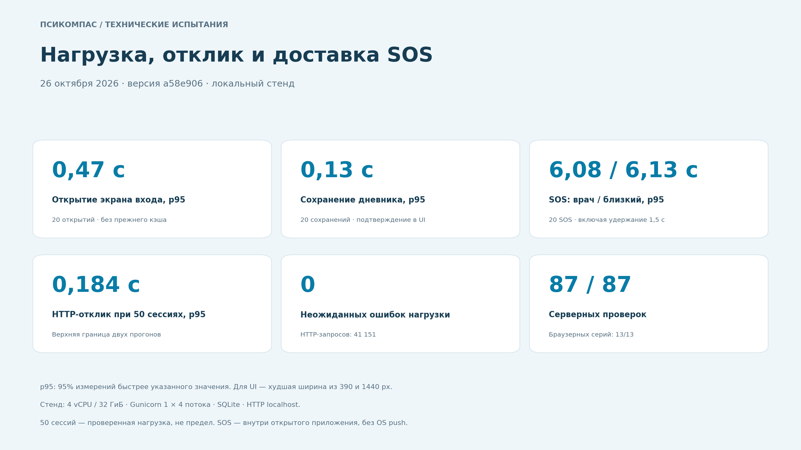

# Замеры для постера: нагрузка, отклик и SOS

Сеанс начат 26.10.2026. Проверена версия приложения `a58e906bdc5f688e7061de7e142641a51ebf2987` в ветке `design/experiments`. Во время тестирования код приложения не менялся; в `browser_smoke` исправлено устаревшее ожидаемое название в расписании лекарств.

## Цифры для раздела 06

| Показатель | Измеренный результат | Что именно проверено |
| --- | --- | --- |
| Открытие экрана входа | p95 **0,47 с** | 20 запусков в новом браузерном контексте; худшее p95 из ширин 390 и 1440 px |
| Сохранение дневника | p95 **0,13 с** | 20 сохранений: клик → HTTP 201 → запись в актуальном состоянии и истории |
| SOS врачу | p95 **6,08 с** | 20 реальных удержаний; от начала удержания до появления уведомления в открытой панели |
| SOS близкому | p95 **6,13 с** | Те же 20 SOS; отдельная сессия разрешённого близкого |
| Отклик при 50 активных сессиях | p95 **≤ 0,184 с** | Два прогона; фактические p95 — 183,489 и 183,115 мс |
| Неожиданные ошибки нагрузки | **0 из 41 151 запроса** | Несовпадение ожидаемого кода, 5xx, timeout и транспортные ошибки |
| Сохранность после остановки процесса | **50 из 50 записей** | Принудительный останов, перезапуск, сверка подтверждённых id; целостность SQLite — OK |

`p95` означает, что 95% измерений быстрее указанного значения. Время SOS включает удержание 1,5 с. После начала отправки запроса p95 составляет **4,58 с врачу / 4,63 с близкому**. Все 20 SOS появились у обоих получателей. Получение уведомления не равно прочтению человеком.

> Локальные испытания: 50 одновременно активных сессий; p95 HTTP-отклика ≤ 0,184 с; 41 151 запрос без неожиданных ошибок. Экран входа — p95 0,47 с; сохранение дневника — p95 0,13 с. SOS — p95 6,08 с врачу и 6,13 с близкому, включая удержание кнопки 1,5 с, в открытом приложении.

Для строки «Нагрузка и отклик» достаточно первых двух показателей из цитаты и подписи **«локальный стенд»**. Остальные цифры можно вынести в отдельные карточки.

## Как измеряли

Все **87/87 серверных тестов**, **13/13 браузерных серий**, запуск планировщика Gunicorn и синтаксис **14/14 JavaScript-файлов** прошли. В измерительном браузерном сценарии ошибок JavaScript, HTTP 5xx и прерванных запросов — 0. Отдельные проверки неверных данных корректно отклоняют запросы; ожидаемые отказы не считаются сбоями.

Стенд: 4 vCPU по квоте, 32 ГиБ по лимиту; Gunicorn — 1 worker / 4 threads, SQLite, HTTP localhost. Клиент и сервер на одной машине. Каждая нагрузочная ступень — 2 с прогрева и 12 с измерений, два повтора для 1/5/10/25/50 сессий. Сессия без паузы отправляет следующий запрос после ответа предыдущего; это автоматические активные сессии, а не физические телефоны.

База нагрузки: 100 добавленных пациентов с 20 историческими записями на каждого плюс штатные фикстуры. При 5 и более сессиях 20% сессий врача и 80% отдельных пациентов. Запросы: карты, списки, уведомления, дневник, отметки лекарств и чат. Перед каждой ступенью восстанавливается одинаковый снимок базы. TLS, внешняя сеть, аутентификация, статика и доставка OS push в эти цифры не входят.

Браузерные замеры выполнены отдельно от нагрузки. Chromium, ширины 390/1440 px. Открытие входа — без прежнего браузерного кэша, но при уже работающем сервере. Сохранение дневника — после ввода текста и прокрутки к кнопке, включая подтверждение в интерфейсе и накладные расходы Playwright. Это конкретные пользовательские операции, не метрики LCP или INP.

У SOS используется штатный polling каждые 5 с. Клики отправлялись со случайными паузами 0,1–5,1 с плюс удержание, без ожидания предыдущей доставки. Врач и близкий — отдельные авторизованные контексты с открытыми панелями. Автообновление не форсировалось. Время появления зафиксировано MutationObserver. Выборка 20 небольшая; p95 рассчитан по nearest rank, без удаления выбросов.

## Границы результата

50 сессий — наибольшая проверенная ступень, а не найденный предел сервера. Время ответа растёт с нагрузкой. Короткий тест без ошибок не доказывает годовую доступность или отсутствие всех дефектов.

Публичный `https://psicompass-demo.onrender.com` из среды проверки недоступен: CONNECT-прокси возвращает 403 до TLS. Это ответ прокси среды, не самого приложения. Полученные локальные цифры нельзя выдавать за результаты Render.

Не измерены системные push на закрытом устройстве, физические iPhone/Android, Safari, внешний ИИ и Telegram. SOS — запрос поддержки внутри приложения; экстренная служба не вызывается, немедленный ответ не гарантируется. Для публичного пилота нужны отдельные замеры на его сервере, через HTTPS и реальную сеть, включая холодный старт Render.

Скрипты и порядок воспроизведения: [tests/measurements](../tests/measurements/README.md). [Полный PDF-отчёт](technical-metrics-2026-10-26.pdf). Исходные CSV/JSON, графики, скриншоты и журналы приложены к архиву в чате.
